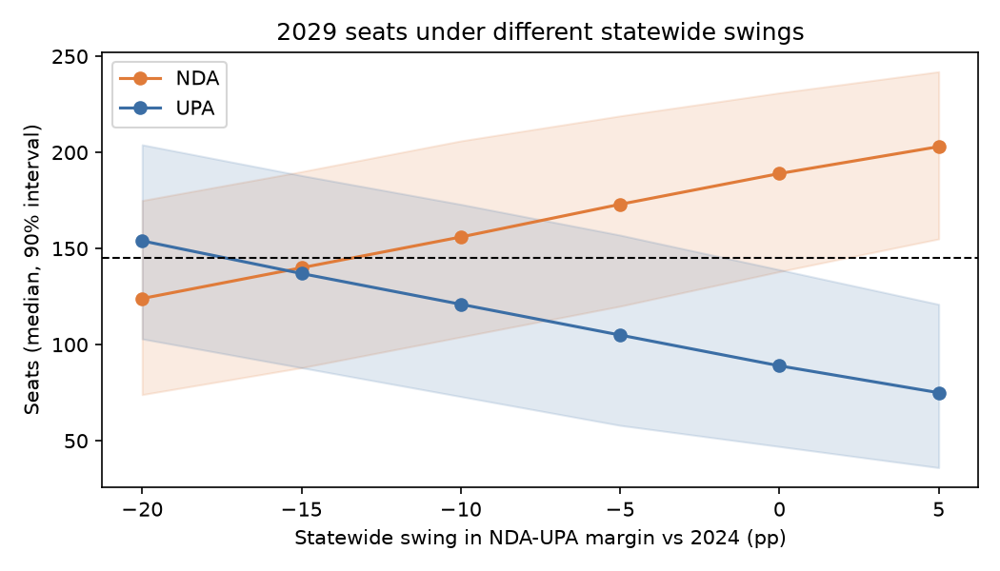
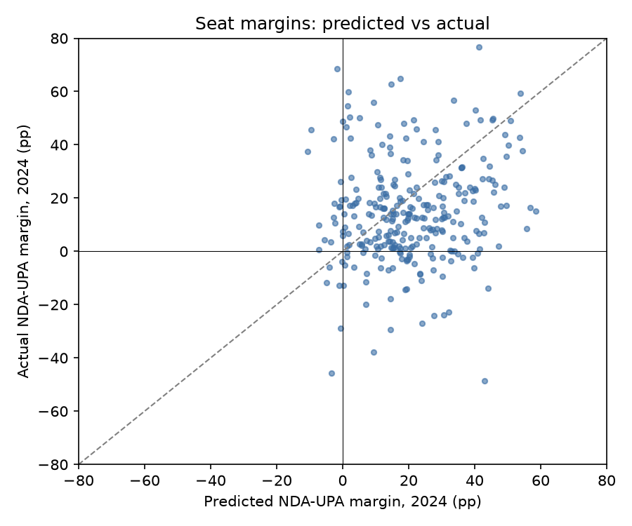
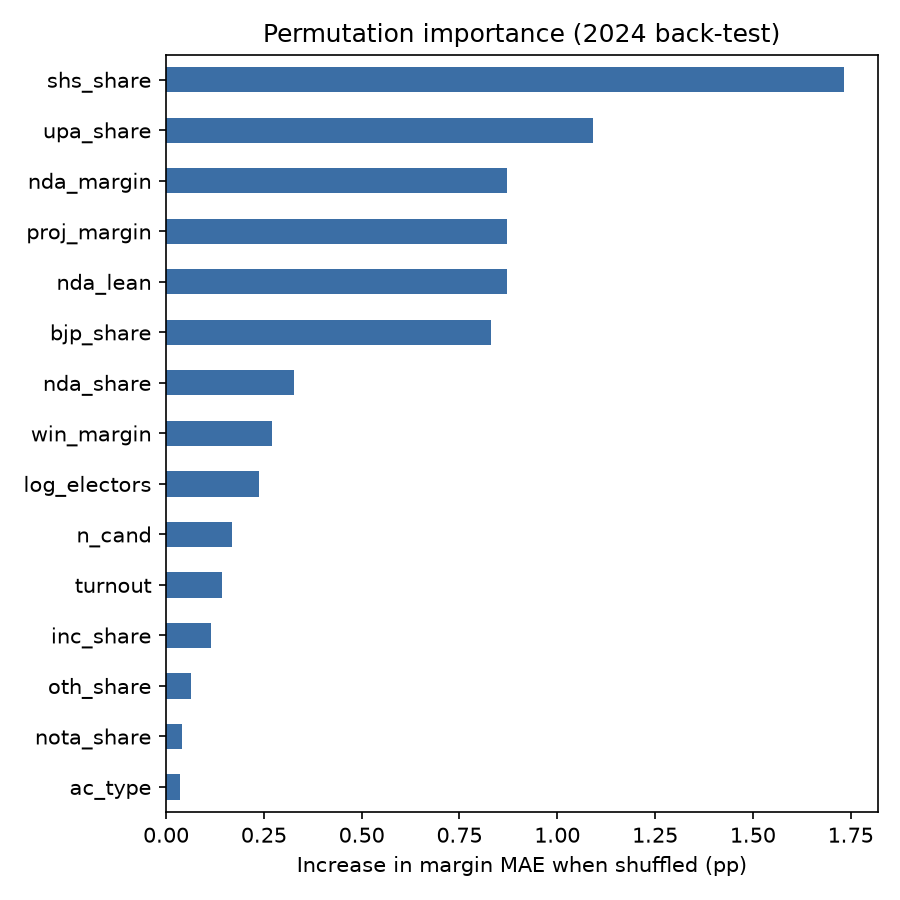

# Maharashtra Assembly Election Forecasting (ML Project)


A seat-level machine-learning model for the **288-seat Maharashtra Vidhan Sabha**. It is trained on real constituency results from **2014, 2019 and 2024**, tested out-of-time on the 2024 election, and used to forecast **2029** under different statewide-swing scenarios. An interactive **Streamlit dashboard** shows the results.

> NDA = BJP-led camp (Mahayuti in 2024) · UPA = Congress-led camp (Maha Vikas Aghadi in 2024) · OTH = everyone else (independents, VBA, MNS, AIMIM, …)



---

## Why this is harder than it looks

Between 2019 and 2024, **Shiv Sena and NCP both split, and their halves joined opposite alliances**. As a result:

- the correlation of seat-level NDA−UPA margins between 2019 and 2024 is only **0.23**;
- 2014 was a four-cornered contest, while 2019 and 2024 were alliance-vs-alliance.

A plain classifier that learns "who won here last time" breaks under these conditions. This project models them explicitly:

1. **Alliance-aware data model.** Every party is mapped to a camp *per election* ([`src/config.py`](src/config.py)), so SHS → NDA in 2019 while SHS (UBT) → UPA in 2024.
2. **Swing decomposition.** A seat's next margin is modelled as:

   `last margin + statewide swing + seat deviation`

   - The ML model predicts the **seat deviation**, which carries over from one election to the next.
   - The **statewide swing** is the one thing two training examples per seat cannot teach. It is an input: the actual swing for back-testing, and a scenario or opinion-poll value for the forecast.
3. **Calibrated uncertainty.** A Monte Carlo simulator draws correlated **region**, **district** and **seat** errors. Their sizes come from out-of-sample residuals: in the back-test, the region and district shared errors were each about 10 pp. Drawing seat errors independently would make the seat-total intervals far too narrow.

## Data

All data is public and lives in [`data/raw`](data/raw), re-downloadable with `python src/download_data.py`.

| File | Source | Content |
|---|---|---|
| `mh_2014.csv`, `mh_2019.csv` | [TCPD Lok Dhaba](https://lokdhaba.ashoka.edu.in/) via [OpenCity](https://data.opencity.in/) | Candidate-level results, turnout, electors, region |
| `mh_2024.csv` | ECI final results via OpenCity | Candidate-level votes (EVM + postal) |
| `mh_2024_electors.csv` | CEO Maharashtra via OpenCity | Electors per constituency (for 2024 turnout) |

All three elections use the same 2008 delimitation (identical constituency numbers). The cleaned data reproduces the official seat tallies (for example, BJP won 122, 105 and 132 seats in 2014, 2019 and 2024), and [tests](tests/test_pipeline.py) enforce this.

## Method

| Stage | Rows | Use |
|---|---|---|
| 2014 features → 2019 outcome | 288 | training and model selection (5-fold CV) |
| 2019 features → 2024 outcome | 288 | **held-out back-test** |
| 2024 features → 2029 | 288 | forecast (final model refit on both labelled transitions) |

**Features per seat** ([`src/features.py`](src/features.py)):

- camp vote shares and NDA−UPA margin
- seat lean relative to the state
- winner's margin
- vote shares of BJP, Shiv Sena, INC, NCP, VBA, MNS, AIMIM, BSP, independents and NOTA (party factions are merged into their parent voter base)
- turnout, electorate size, number of candidates and effective number of parties
- SC/ST/GEN reservation and region
- swing-projected margin

**Model** ([`src/model.py`](src/model.py)):

- **Margin model:** a Ridge regressor predicts the deviation from uniform swing. It was selected on training-CV error against random forest and gradient boosting.
- **Others model:** a logistic classifier gives P(seat won by neither camp).
- **Simulator:** 5,000 simulated elections produce seat probabilities, seat-total intervals and P(majority ≥ 145).

## Results: 2024 back-test (trained on 2014→2019 only)

The back-test is given the actual 2024 statewide swing, so it measures how well the model distributes a known vote swing across seats.

| Model | Seat accuracy | Margin MAE (pp) | NDA / UPA / OTH seats |
|---|---|---|---|
| Persistence (same camp as 2019) | 58.0% | – | 163 / 100 / 25 |
| Uniform swing | 68.8% | 21.5 | 212 / 76 / 0 |
| Logistic regression classifier | 67.0% | – | 212 / 59 / 17 |
| Random forest classifier | 59.0% | – | 171 / 117 / 0 |
| **Swing model (Ridge), selected** | **77.1%** | **18.3** | 265 / 23 / 0 |
| Swing model (random forest) | 77.1% | 17.4 | 261 / 27 / 0 |
| **Full probabilistic model** | **76.7%** | 18.3 | 259 / 21 / 8 |
| *Actual 2024* | | | *235 / 50 / 3* |

What these numbers show:

- **The swing model beats both baselines.** It gets 8 points more seats right than uniform swing and 19 points more than persistence.
- **Direct classifiers transfer poorly.** They learn the 2019 base rates and cannot adapt to a different statewide mood.
- **The model correctly gives the NDA a majority** with probability ≈ 1.0, given the vote swing.
- **The seat interval was too narrow.** The simulated 90% interval for NDA seats was 175–209, and the actual 235 fell outside it. Counting the most likely winner per seat overshoots (259). The 2024 realignment moved seats more coherently than any noise model fitted on 2014→2019 expected. Seat-total intervals should therefore be read as *optimistic about precision*.

| | |
|---|---|
|  |  |

The most important feature is the prior **Shiv Sena vote share**, which is exactly where the 2022 split redistributed votes.

## 2029 forecast

A swing of 0 means the same statewide NDA−UPA margin as in 2024 (+14.6 pp). The uncertainty around each swing is ±5 pp (SD).

| Swing vs 2024 | NDA seats (median, 90% interval) | UPA seats (median) | P(NDA majority) | P(UPA majority) |
|---|---|---|---|---|
| +5 | 203 (155–242) | 75 | 98% | 1% |
| **0** | **189 (138–231)** | **89** | **93%** | **4%** |
| −5 | 173 (120–219) | 105 | 83% | 10% |
| −10 | 156 (104–206) | 121 | 66% | 21% |
| −15 | 140 (88–190) | 137 | 44% | 40% |
| −20 | 124 (74–175) | 154 | 24% | 64% |

How to read this:

- **The NDA keeps an edge until the statewide margin swings about 15 pp toward the MVA.** At that point the race is roughly a toss-up.
- **At zero swing the median (189) is below the 235 seats the NDA won in 2024.** The model expects reversion in individual seats even if the statewide vote holds. That is what the 2014→2019→2024 history shows, but see the back-test caveat above.
- **These are scenarios, not a prediction of the 2029 statewide vote.** That depends on events after 2024: alliance changes, leadership and the national mood.

### Current conditions (as of October 2026)

Several things have changed since the November 2024 election. The table shows how each one is handled:

| Development since 2024 | How it is handled |
|---|---|
| **Local elections, Dec 2025 – Jan 2026:** Mahayuti swept the municipal corporations. BJP won 1,416 corporators, Shiv Sena 397, NCP 160, Congress 324, Shiv Sena (UBT) 153, NCP (SP) 36. BJP became the largest party in Mumbai's corporation (89 of 227). | Evidence for keeping the **default swing at 0**: there is no sign of a shift away from the NDA. Local elections are a different kind of contest and only seat counts are published, so they are not fed into the model as data. |
| **Shiv Sena (UBT) allied with MNS** for the Mumbai corporation polls | Alliance option `thackeray_alliance`: MNS's 2024 votes count toward the MVA |
| **Congress contested the local polls alone** | Alliance option `congress_alone`: Congress counts as a separate force, so the opposition vote is split |
| **Ajit Pawar died on 28 Jan 2026.** Sunetra Pawar now leads NCP and holds Baramati. | Not modelled: its effect on the NCP vote can't be measured without polling |

Results with the 2024 statewide mood held constant (swing 0):

| Alliance structure | NDA (median) | MVA (median) | Others (median) | P(NDA majority) |
|---|---|---|---|---|
| 2024 alliances | 189 | 89 | 10 | 93% |
| Shiv Sena (UBT) + MNS | 185 | 93 | 10 | 91% |
| Congress contests separately | 207 | 67 | 14 | 99% |
| Both changes | 204 | 70 | 14 | 99% |

The Thackeray tie-up adds only a few seats to the opposition, because MNS took about 1.5% of the statewide vote in 2024. A Congress–MVA split is far more damaging to the opposition.

That last scenario is approximate. The model never saw a split opposition in training, so Congress's own wins are probably under-counted in "Others".

Run the alliance scenarios from the command line with `python src/forecast.py --alliances thackeray_alliance congress_alone`, or switch them on in the dashboard sidebar.

## Run it

```bash
pip install -r requirements.txt

python src/preprocess.py     # raw CSVs -> tidy tables
python src/train.py          # model comparison, 2024 back-test, saves models/
python src/forecast.py       # 2029 forecast + scenario sweep (--swing -8 for a custom one)
streamlit run app.py         # interactive dashboard
python -m pytest -q          # tests
```

The dashboard has four tabs:

- **Forecast:** a swing slider, seat distribution, expected seats per region and the list of battleground seats.
- **Constituency explorer:** win probabilities per seat, with each seat's top candidates in 2014, 2019 and 2024.
- **2024 back-test:** the model comparison table and diagnostic charts.
- **History:** seats won by camp and by party in each election.

## Project structure

```
├── app.py                      Streamlit dashboard
├── data/raw/                   downloaded results (2014, 2019, 2024) + 2024 electors
├── data/processed/             tidy tables and per-transition feature sets
├── models/election_model.joblib
├── reports/                    metrics.json, back-test + forecast CSVs, figures/
├── src/
│   ├── config.py               paths, sources, party -> alliance maps per year
│   ├── download_data.py
│   ├── preprocess.py           cleaning, camp assignment, seat stats
│   ├── features.py             seat snapshots and transition datasets
│   ├── model.py                regressor + OTH classifier + Monte Carlo simulator
│   ├── train.py                comparison, back-test, final fit
│   └── forecast.py             2029 scenarios
└── tests/                      pytest suite (runs in GitHub Actions)
```

## Limitations and next steps

- **Only two transitions to learn from.** Adding 2009 (pre-delimitation, which would need boundary mapping) or Lok Sabha 2019 and 2024 results by assembly segment would roughly double the training signal.
- **No candidate-level information** such as incumbency, defections or rebels. TCPD provides incumbency for 2014 and 2019, but it is not available here for 2024.
- **The camp mappings are a modelling choice.** Small allies are assigned to camps in [`src/config.py`](src/config.py) and can be edited there.
- **The statewide swing is exogenous.** Feeding it from opinion polls or the 2029 Lok Sabha results would turn the scenario tool into a forecast.

## License

[MIT](LICENSE) for the code. The election data belongs to its original publishers (ECI and TCPD Lok Dhaba via OpenCity), and their terms apply.
